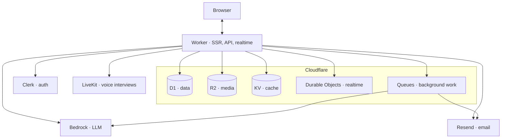
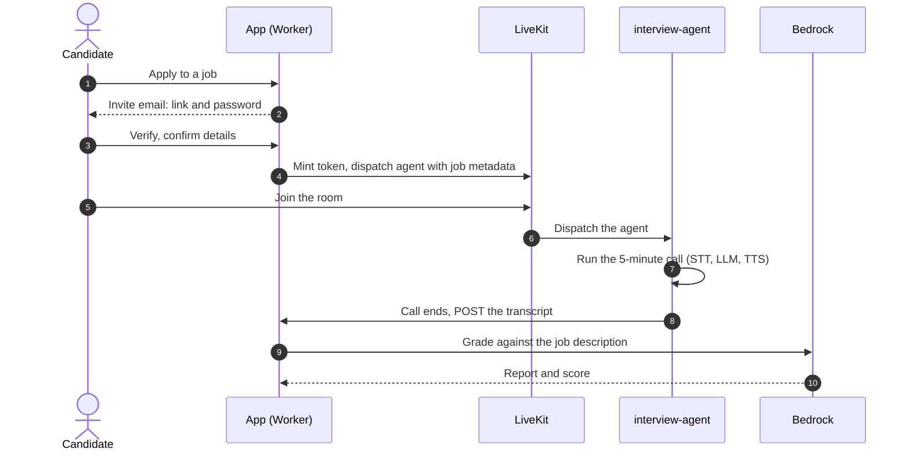
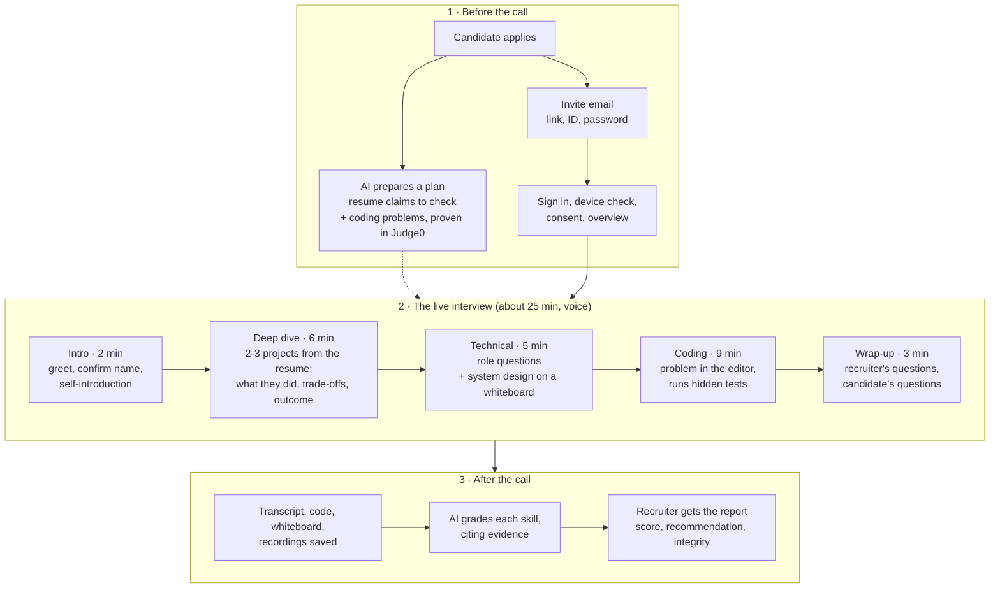
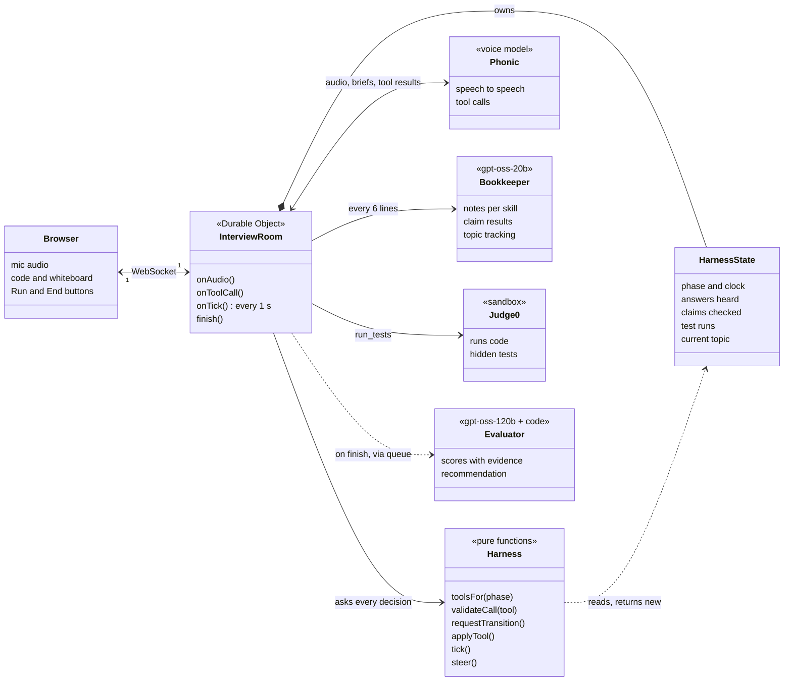
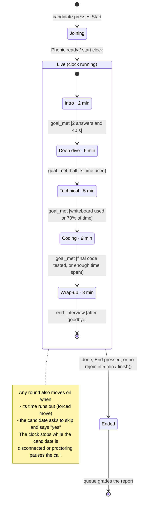

<p align="center">
  <picture>
    <source media="(prefers-color-scheme: dark)" srcset="public/logo-dark.png">
    
  </picture>
</p>

<h1 align="center">Hirely AI</h1>

<p align="center">
  A professional network where AI runs the first interview.<br>
  <a href="https://hire-excellence.n1m35h.in">hire-excellence.n1m35h.in</a>
</p>

---

## Features

- **AI voice interviews:** a 5-minute LiveKit interview, graded against the job description
- **MCQ screening:** AI-generated or hand-written, with a server-side timer and grading
- **Jobs:** post, apply, and track applicants through a simple pipeline
- **Network & feed:** connections, follows, posts, realtime updates
- **Resume:** upload a PDF and your profile fills itself in
- **Company pages:** verified by work email, one page per domain

## Architecture



Next.js 16 on [vinext](https://github.com/cloudflare/vinext) deploys as one Cloudflare Worker, styled with Tailwind v4. D1 holds the data, R2 the media, KV a read-mostly cache, and a Durable Object pushes realtime feed updates over WebSockets. Slow work (AI grading, invite emails, notification fan-out) goes through Queues back into the same Worker, retried with backoff and parked in a dead-letter queue when it keeps failing.

## Voice interview



The app mints a LiveKit token whose room config dispatches [the voice agent](voice-agent/README.md) (registered with LiveKit as `interview-agent`) with the job, candidate and questions as metadata. The agent runs the call (5-minute hard limit) on LiveKit Inference: AssemblyAI streaming STT, Gemma 4 31B, Inworld TTS, no extra keys. When the call ends it POSTs the transcript to `/api/interview/complete`, a queue grades it with Bedrock, and the poster gets the report.

## AI interview



The candidate talks to a voice interviewer (Phonic speech-to-speech) while the `InterviewRoom` Durable Object runs a harness that decides everything else: which round it is, which tools exist (editor, tests, whiteboard), when to move on, and when the clock forces a round to end. The clock pauses on reconnects and proctoring pauses, skips need the candidate's "yes", and a flexible mode lets the call run up to 60 minutes. Scores come from a separate grader and the final numbers are computed in code, never written by the model. See [docs/ai-interview-flow.md](docs/ai-interview-flow.md) for the full flow, tool calls and harness, and [docs/](docs/README.md) for all docs.

### The harness

**Class diagram: who does what.** The room owns the state; the harness is pure functions that read it and return a new one. Phonic only talks and asks for tools; it never decides.



**State machine: how the interview moves.** Arrows read `event [guard] / action`. The agent can only _ask_ to move on (`request_phase_transition`); the harness approves it when the guard holds and otherwise tells the agent what to do instead.



| Round     | Tools the agent gets                                                    |
| --------- | ----------------------------------------------------------------------- |
| Every one | `request_phase_transition`                                              |
| Technical | `open_whiteboard`, `read_whiteboard`, `close_whiteboard` (if design on) |
| Coding    | `run_tests`, `switch_problem`                                           |
| Wrap-up   | `end_interview`                                                         |

## Getting started

```bash
git clone https://github.com/GitNimay/hire-excellence.git
cd hire-excellence
npm install
npm run db:migrate:local
npm run dev
```

Add your keys to `.env.local` (Clerk, Bedrock, Resend, LiveKit, Turnstile) and point `wrangler.jsonc` at your own D1 and KV IDs.

## Scripts

| Command                    |                                                 |
| -------------------------- | ----------------------------------------------- |
| `npm run dev`              | Dev server on :3000                             |
| `npm test`                 | All tests (unit + integration)                  |
| `npm run test:unit`        | Unit tests only (fast, no database)             |
| `npm run test:integration` | Integration tests against a local D1 and R2     |
| `npm run test:watch`       | Re-run affected tests on save                   |
| `npm run test:coverage`    | All tests with a coverage report in `coverage/` |
| `npm run typecheck`        | Type check                                      |
| `npm run deploy`           | Build, migrate, deploy                          |

## Tests

[Vitest](https://vitest.dev), in two projects (`vitest.config.ts`):

- **Unit**, next to the code (`lib/*.test.ts`, `app/**/*.test.ts`): pure logic, plus modules whose only outside calls (fetch, Clerk, analytics) are mocked. No database.
- **Integration** (`tests/integration/`): code that reads or writes D1 and R2 runs against a real local database. A global setup applies every file in `migrations/` with `wrangler d1 migrations apply`, and each test file gets its own copy, so files run in parallel. Tests build their own rows with the factories in `tests/integration/factories.ts` and never depend on each other. Only Clerk, the realtime Durable Object, Bedrock and other external HTTP calls are mocked.

The integration Worker config (`tests/integration/wrangler.jsonc`) has dummy values and no `.dev.vars`, so tests never see real secrets or touch remote resources. CI runs everything with coverage and fails below the floor set in `vitest.config.ts`. The CI `integration` job then smoke-tests the built Worker over HTTP.

---

<p align="center"><sub>Emoji reactions adapted from <a href="https://github.com/swamimalode07/rare-ui">rare-ui</a> · All rights reserved.</sub></p>
